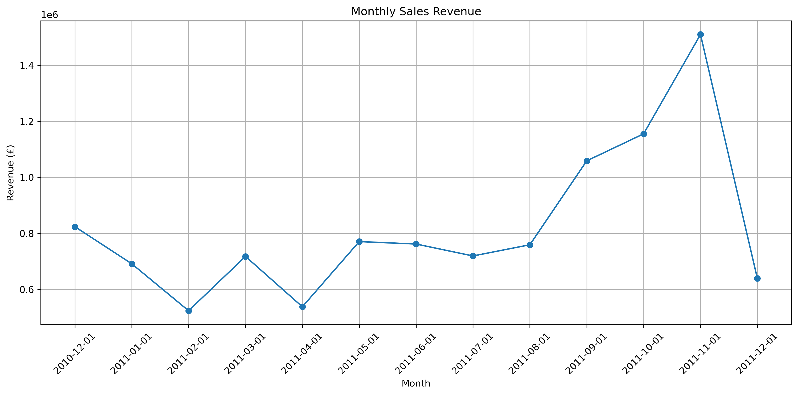

# Online kiskereskedelmi adatok elemzése

## Áttekintés

Ez a projekt egy Python-alapú adatelemző eszköz, amely az UCI Online Retail adatkészletének feldolgozására és elemzésére készült.

A projekt **Pandas** könyvtárat használ az adatok kezeléséhez és elemzéséhez, valamint **Matplotlib** könyvtárat az adatok vizualizálásához. Egy interaktív menürendszer segítségével lehetővé teszi az értékesítési teljesítmény, a vásárlói aktivitás, a termékek teljesítménye és az országonkénti bevételek vizsgálatát.

Az eszköz emellett támogatja az elemzési eredmények CSV-fájlokba történő exportálását és az ábrák PNG-képként való mentését.

## Adatkészlet

A projekt az [UCI Machine Learning Repository Online Retail adatkészletét](https://archive.ics.uci.edu/dataset/352/online+retail) használja.

Az adatkészlet 541 909 tranzakciós rekordot tartalmaz egy egyesült királyságbeli online kiskereskedőtől, 2010 decembere és 2011 decembere közötti időszakból.

Az adatok többek között a következő információkat tartalmazzák:
- Számlaszámok
- Termékkódok és termékleírások
- Vásárolt mennyiségek
- Tranzakciók dátumai
- Egységárak
- Vásárlói azonosítók
- Országok

Az eredeti adatkészlet nem része ennek a GitHub-tárolónak. A használatához töltsd le az UCI Machine Learning Repository oldaláról.

## Funkciók

### Adatok betöltése és előkészítése
- Az Excel-adatkészlet betöltése a Pandas segítségével.
- Az adatok szerkezetének és adattípusainak vizsgálata.
- Hiányzó értékek és szokatlan tranzakciós rekordok azonosítása.
- Külön, kizárólag értékesítési adatokat tartalmazó adathalmaz létrehozása a bevételelemzéshez.
- A tranzakciók bevételének kiszámítása a mennyiség és az egységár szorzataként.

### Értékesítési és vásárlói elemzések

Az eszköz a következő elemzéseket teszi lehetővé:

1. Legnagyobb bevételt generáló termékek
2. Legnagyobb bevételt generáló vásárlók
3. Havi bevételek
4. Országonkénti bevételek
5. Legnagyobb mennyiségben értékesített termékek
6. Vásárlók rangsorolása a rendelések száma alapján
7. Átlagos rendelési érték vásárlónként

### Adatvizualizáció

A projekt négy különböző ábrát készít a Matplotlib segítségével:

- Havi értékesítési bevétel
- Országonkénti bevétel
- Legnagyobb bevételt generáló termékek
- Legnagyobb bevételt generáló vásárlók

Az ábrák az interaktív menürendszeren keresztül megjeleníthetők, valamint nagy felbontású PNG-képfájlként is elmenthetők.

#### Példák az elkészített ábrákra

<table>
  <tr>
    <td align="center">
      
       **Országonkénti bevételek**
    </td>
    <td align="center">
      
       **Legnagyobb bevételt generáló vásárlók**
    </td>
  </tr>
  <tr>
    <td align="center">
      
       **Legnagyobb bevételt generáló termékek**
    </td>
    <td align="center">
      
       **Havi bevételek**
    </td>
  </tr>
</table>

### Adatok exportálása

Az elemzési eredmények CSV-fájlokba exportálhatók, így később további vizsgálatokhoz vagy táblázatkezelő programokban is felhasználhatók.

A projekt jelenleg a következő eredmények exportálását támogatja:
- Legnagyobb bevételt generáló termékek
- Legnagyobb bevételt generáló vásárlók
- Havi bevételek
- Országonkénti bevételek

## Felhasznált technológiák

- **Python** – Fő programozási nyelv
- **Pandas** – Adatok betöltése, tisztítása, csoportosítása és elemzése
- **Matplotlib** – Adatvizualizáció
- **OpenPyXL** – Excel-fájlok beolvasása
- **Jupyter Notebook** – Fejlesztési és tesztelési környezet

## Telepítés és használat

### 1. A GitHub-tároló klónozása

https://github.com/Kingofthemducks/CSV-Data-Analysis-Tool-using-Python-Jupyter-Notebook-

### 3. Az adatkészlet letöltése

Töltsd le az Online Retail adatkészletet az [UCI Machine Learning Repository](https://archive.ics.uci.edu/dataset/352/online+retail) oldaláról.

Helyezd a letöltött `Online Retail.xlsx` fájlt a projekt mappájába, a `CSV Data Analysis Tool.ipynb` fájl mellé.

### 4. A Jupyter Notebook megnyitása

Indítsd el a Jupyter Notebookot:

Nyisd meg a `notebooks/CSV Data Analysis Tool.ipynb` fájlt, majd futtasd a cellákat sorrendben.

## Bemutatott készségek

- Python programozás
- Adattisztítás és adat-előkészítés
- Feltáró adatelemzés
- Pandas DataFrame-műveletek
- Adatok csoportosítása, összesítése és rendezése
- Dátumok és időszakok kezelése
- Statisztikai és üzleti szemléletű adatelemzés
- Adatvizualizáció
- CSV- és Excel-fájlok kezelése
- Újrafelhasználható függvények és moduláris programozás
- Interaktív parancssori menürendszer készítése
- Fájlok és mappák kezelése

## A projekttel kapcsolatos megjegyzések

A projekt gyakorlati tanulási feladatként készült, a programozási és adatelemzési készségek fejlesztése érdekében.

Az értékesítési elemzés kizárólag a pozitív mennyiséggel és pozitív egységárral rendelkező rekordokat használja, a törölt számlák kizárásával. Ez egy kizárólag értékesítési tranzakciókra épülő elemzést biztosít, és nem tekinthető a visszatérítésekkel és visszárukkal korrigált nettó bevételnek.

Néhány rekordból hiányzik a vásárlói azonosító, ezért a vásárlókhoz kapcsolódó elemzések csak az azonosítható vásárlók tranzakcióit veszik figyelembe.

Az adatkészlet 2011. december 9-én ér véget, ezért a 2011. decemberi adatok csak a hónap egy részét fedik le.

## Továbbfejlesztési lehetőségek

A projekt a jövőben a következő funkciókkal bővíthető:
- Rugalmasabb elemzési szűrők
- További vásárlói és termékelemzések
- Fejlettebb exportálási lehetőségek
- Grafikus felhasználói felület
- Automatizált adatminőség-ellenőrzés

## Készítő

Saját Python-alapú adatelemzési projektként készült.
