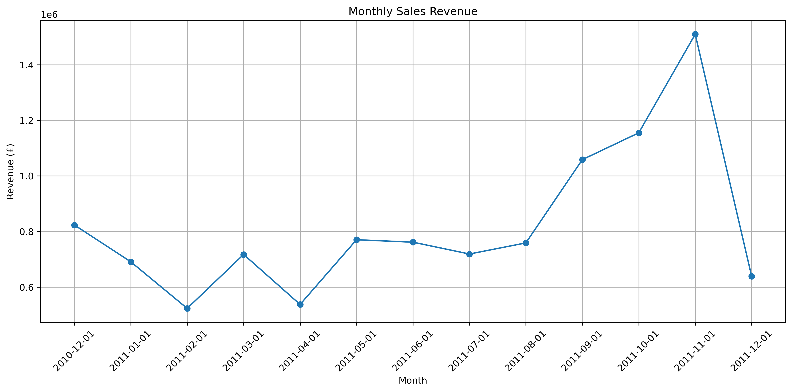

# Online Retail Data Analysis Tool

## Overview

This project is a Python-based data analysis tool developed to explore and analyse the UCI Online Retail dataset.

The project uses **Pandas** for data manipulation and analysis, and **Matplotlib** for data visualisation. It provides an interactive menu that allows users to explore sales performance, customer activity, product performance and revenue across different countries.

The tool also supports exporting analysis results to CSV files and saving charts as PNG images.

## Dataset

The project uses the [Online Retail dataset from the UCI Machine Learning Repository](https://archive.ics.uci.edu/dataset/352/online+retail).

The dataset contains transactions from a UK-based online retailer between December 2010 and December 2011.

It includes information such as:
- Invoice numbers
- Product codes and descriptions
- Quantities purchased
- Invoice dates
- Unit prices
- Customer IDs
- Countries

The original dataset is not included in this repository. Please download it from the UCI Machine Learning Repository.

## Features

### Data loading and preparation
- Loads the Excel dataset using Pandas.
- Inspects the dataset structure and data types.
- Identifies missing values and unusual transaction records.
- Creates a sales-only dataset for revenue analysis.
- Calculates transaction revenue using quantity multiplied by unit price.

### Sales and customer analysis

The tool provides the following analyses:

1. Top products by revenue
2. Top customers by revenue
3. Monthly revenue
4. Revenue by country
5. Top products by quantity sold
6. Top customers by number of orders
7. Average order value by customer

### Data visualisation

<table>
  <tr>
    <td align="center">
      
      <br>Top Countries by Sales Revenue
    </td>
    <td align="center">
      
      <br>Top Customers by Sales Revenue
    </td>
    <td align="center">
      
      <br>Top Products by Sales Revenue
    </td>
    <td align="center">
      
      <br>Monthly Revenue
    </td>
  </tr>
</table>

The project generates four charts using Matplotlib:

- Monthly sales revenue
- Revenue by country
- Top products by revenue
- Top customers by revenue

Charts can be saved as high-resolution PNG images.

### Data export

Analysis results can be exported as CSV files for further examination or use in spreadsheet applications.

## Technologies Used

- **Python** – Main programming language
- **Pandas** – Data loading, cleaning, grouping and analysis
- **Matplotlib** – Data visualisation
- **OpenPyXL** – Reading Excel files
- **Jupyter Notebook** – Development and testing environment

## Project Structure

```text
CSV-Data-Analysis-Tool/
├── data/
├── charts/
├── exports/
├── screenshots/
├── src/
├── requirements.txt
├── .gitignore
└── README.md
```

## Installation and Usage

### 1. Clone the repository

```bash
git clone YOUR_GITHUB_REPOSITORY_URL
cd CSV-Data-Analysis-Tool
```

### 2. Install dependencies

```bash
pip install -r requirements.txt
```

### 3. Download the dataset

Download the Online Retail dataset from the UCI Machine Learning Repository and place the Excel file in the project's data folder.

### 4. Run the application

Run the Python program from the project directory.

```bash
python src/main.py
```

Follow the interactive menu to select an analysis, display a chart or export results.

## Skills Demonstrated

- Python programming
- Data cleaning and preparation
- Exploratory data analysis
- Pandas DataFrame operations
- Grouping, aggregation and sorting
- Working with dates and time periods
- Statistical and business-oriented analysis
- Data visualisation
- CSV and Excel file handling
- Reusable functions and modular programming
- Interactive command-line menus
- File and folder management

## Project Notes

This project was developed as a practical learning project to build programming and data analysis skills.

The sales analysis uses records with positive quantities and positive unit prices, excluding cancelled invoices. This creates a sales-only view and does not represent net revenue after refunds or returns.

Some records have missing customer IDs, so customer-specific analyses only include transactions with an available customer ID.

The dataset ends on 9 December 2011, meaning December 2011 represents a partial month.

## Future Improvements

Potential future enhancements include:
- More flexible analysis filters
- Additional customer and product insights
- Improved data export options
- A graphical user interface
- Automated data quality reporting

## Author

Developed as a personal Python data analysis project.
